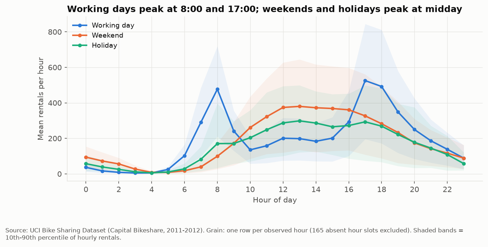
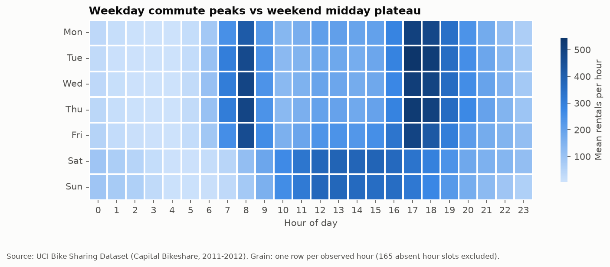
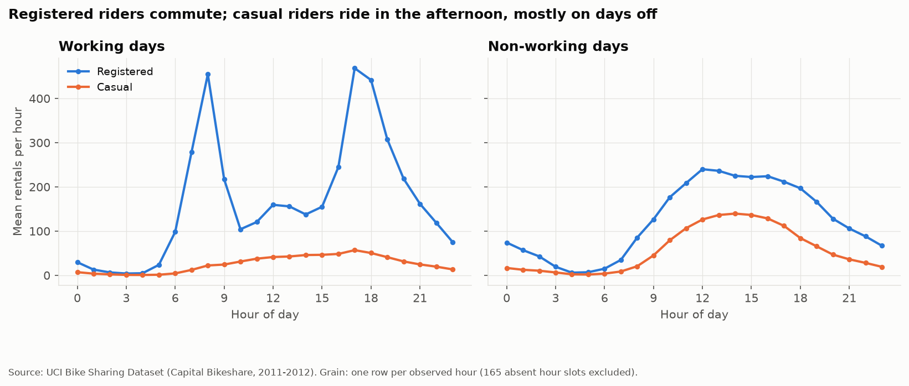
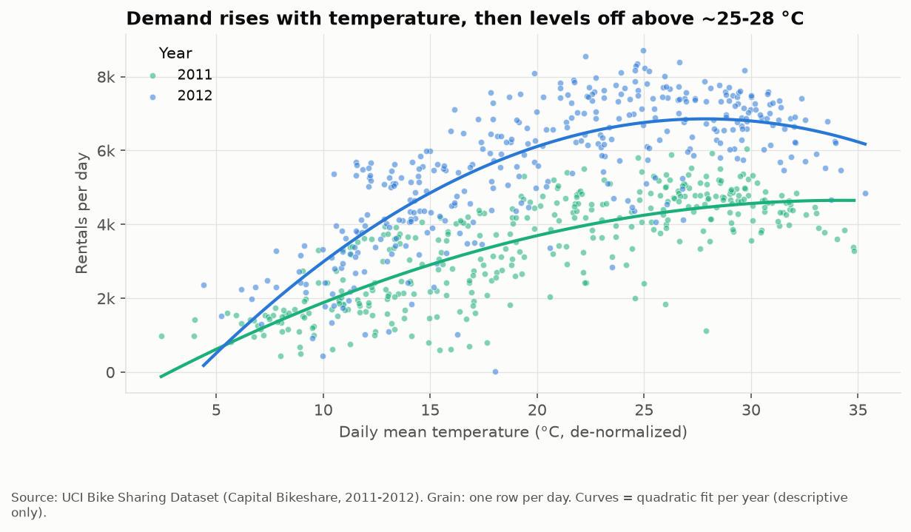
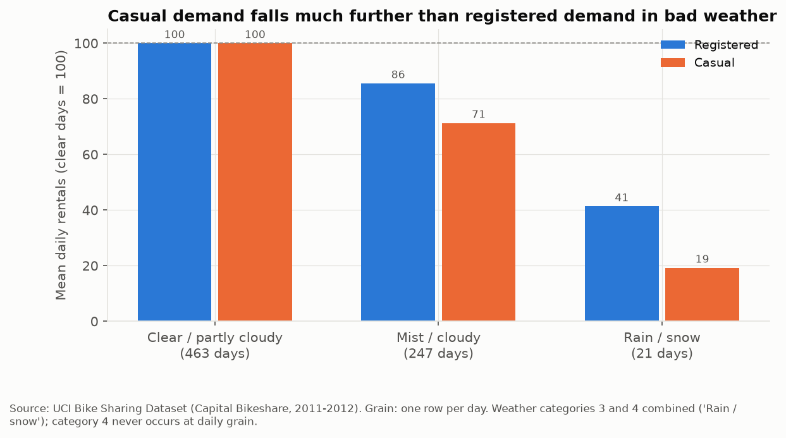
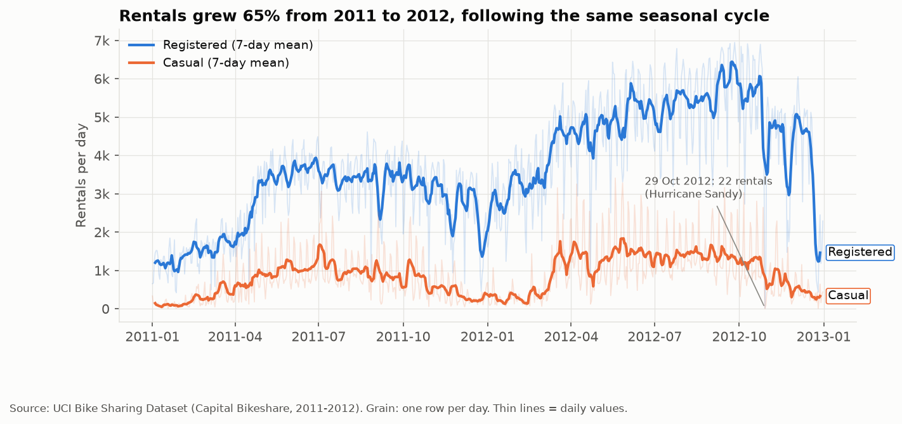
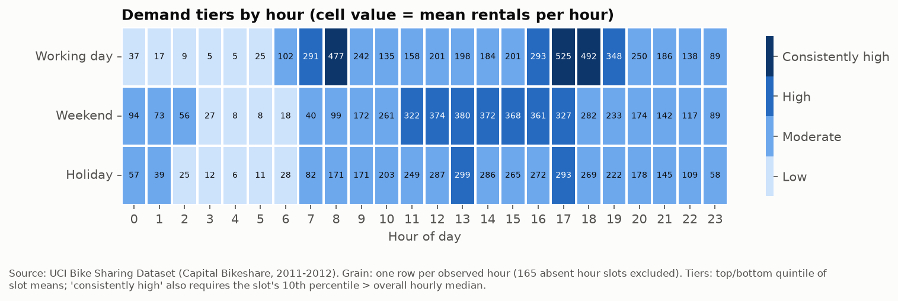

# Bike Sharing Demand & Usage Pattern Analysis

An end-to-end analysis of the **UCI Bike Sharing Dataset**: two years (2011-2012) of Capital Bikeshare rentals in Washington D.C. It covers raw-data ingestion and validation, cleaning, exploratory and statistical analysis, a Word report, and an interactive Plotly Dash dashboard.

> **Business question:** What factors and usage patterns are associated with bike rental demand, and how can the operator use these insights to improve service availability and operational planning?



## Key findings

| # | Finding | Evidence |
|---|---|---|
| 1 | **The peaks match commuting times.** Working-day demand peaks at 08:00 and 17:00-18:00; these are the only consistently high-demand slots. | 477-525 mean rentals per hour; weekends instead have a midday plateau (peak 13:00) |
| 2 | **Total volume barely depends on the day type, but the user mix does.** | Casual share 13% on working days vs 32% at weekends. Total difference: d = 0.13 (negligible); casual d = -1.13, registered d = 0.71 |
| 3 | **Season and temperature have strong associations.** Demand peaks around 25-30 °C and levels off above that. | Summer 5,644 vs winter 2,604 rentals per day; Spearman ρ = 0.62 with temperature |
| 4 | **Rain and snow coincide with large drops**, especially for casual riders. | Rain/snow days: 37% of clear-day demand (casual 19%, registered 41%); regression: -1,783 per day |
| 5 | **Strong growth.** Rentals grew 65% from 2011 to 2012; January-March grew fastest (2.1-2.6x). | 1.24M rentals in 2011, 2.05M in 2012 |

**Operational implications** (framed as implications: the data has no station or inventory information):
- Complete rebalancing before the working-day commute peaks.
- Plan weekend capacity around midday.
- Schedule maintenance between 02:00 and 05:00 and in winter.
- Use weather forecasts for short-term staffing.

All findings are associations in observational data, not causal effects.

## Visual highlights

The figures below are the ones that support the key findings above. All 15 charts are in [reports/figures/](reports/figures/).

### Finding 1: Weekday commute peaks vs weekend midday plateau
Mean rentals per hour by weekday and hour of day (`hour.csv`). Working days show two sharp peaks at 08:00 and 17:00-18:00; Saturday and Sunday show a broad midday plateau.



### Finding 2: Registered riders commute, casual riders ride on days off
Casual riders contribute little on working days and follow the weekend midday curve; registered riders drive the commute peaks.



### Finding 3: Demand rises with temperature, then levels off
Each point is one day. Curves are descriptive quadratic fits per year, not causal estimates.



### Finding 4: Casual demand is more weather-sensitive
Mean daily rentals relative to clear days (= 100). Rain/snow days are based on only 21 days, so treat the exact values with caution.



### Finding 5: Growth from 2011 to 2012 follows the same seasonal cycle
7-day mean of daily rentals. The dip at the end of October 2012 coincides with Hurricane Sandy.



### Operational view: demand tiers by hour and day type
Cell values are mean rentals per hour. These are demand tiers from observed rentals, not measured bike availability.



## Deliverables

| Deliverable | Location |
|---|---|
| Analytical report (Word) | [reports/findings/Bike_Sharing_Report.docx](reports/findings/Bike_Sharing_Report.docx) |
| Data quality report | [reports/findings/data_quality.md](reports/findings/data_quality.md) |
| Result tables (CSV) and model summary | [reports/findings/tables/](reports/findings/tables/) |
| Figures | [reports/figures/](reports/figures/) |
| Interactive dashboard | [dashboard/app.py](dashboard/app.py) |
| Narrative notebooks | [notebooks/](notebooks/) |

## Data

- **Source:** [UCI Machine Learning Repository: Bike Sharing Dataset](https://archive.ics.uci.edu/dataset/275/bike+sharing+dataset). Fanaee-T, H. & Gama, J. (2013), *Event labeling combining ensemble detectors and background knowledge*, Progress in Artificial Intelligence.
- `day.csv`: 731 rows, one per day. `hour.csv`: 17,379 rows, one per observed hour.
- **Grain discipline:** intraday analysis uses `hour.csv` only; daily, seasonal and trend analysis uses `day.csv` only. The two are never combined.

### Data-quality decisions
| Issue | Decision |
|---|---|
| 165 hour slots missing from `hour.csv` (59% between 02:00 and 05:00) | Not imputed. Hourly totals reconcile exactly with `day.csv`, so these are zero-rental or outage hours. |
| **The Readme's season labels contradict the dates.** Code 1 ("springer") contains all of January and February. | Seasons relabelled by their dates (1 Winter, 2 Spring, 3 Summer, 4 Fall). The original code is kept. |
| Humidity of 0% on 2011-03-10 | Treated as missing (sensor error). |
| Weather category 4 appears in only 3 hourly records | Merged with category 3 as "Rain / snow". |
| Normalized weather variables | De-normalized per the Readme (temp x41, atemp x50, hum x100, wind x67). |

## Methods

- **Descriptive KPIs.** Each KPI states its grain (per day vs per hour).
- **Working vs non-working days.** Welch t-test and Mann-Whitney U, with Cohen's d and a moving-block bootstrap CI (14-day blocks, because consecutive days are dependent).
- **Seasons.** Kruskal-Wallis (Levene shows unequal variances), with ANOVA as a check and Holm-corrected pairwise tests.
- **Weather correlations.** Pearson and Spearman, with block-bootstrap CIs.
- **Regression.** OLS of daily rentals on centred quadratic temperature, humidity, wind, weather category, season, year and working day, using Newey-West (HAC) errors. R² = 0.85, Durbin-Watson = 1.18, all VIFs below 5.

## Project structure

```text
├── data/
│   ├── bike+sharing+dataset.zip   original archive (never modified)
│   ├── raw/                       extracted original files (git-ignored)
│   ├── interim/                   labelled intermediate tables (git-ignored)
│   └── processed/                 validated day_clean.csv / hour_clean.csv (git-ignored)
├── src/
│   ├── config.py                  paths and documented constants
│   ├── pipeline.py                end-to-end entry point
│   ├── data/                      ingest.py, validate.py, clean.py
│   ├── analysis/                  kpis.py, stats.py, results.py
│   ├── visualization/             style.py, figures.py
│   └── reporting/                 build_report.py (python-docx)
├── notebooks/                     01-06 narrative analysis notebooks
├── dashboard/                     app.py (Dash), charts.py (Plotly figures)
└── reports/
    ├── figures/                   PNG charts used in the report
    └── findings/                  .docx report, data-quality report, result tables
```

## How to run

Requires [uv](https://docs.astral.sh/uv/) and Python 3.12.

```bash
uv venv .venv
uv pip install -p .venv -r requirements.txt
source .venv/bin/activate

python -m src.pipeline          # ingest -> validate -> clean -> analyse -> figures -> Word report
python dashboard/app.py         # dashboard at http://127.0.0.1:8050
jupyter lab notebooks/          # narrative notebooks 01-06
```

The dashboard provides filters for year, season, day type, weather and user type. It has five tabs: Overview, Time patterns, Weather, User segments and Operations.

## Limitations

- **No station, trip, inventory or maintenance data.** Availability, stockouts, station imbalance and unmet demand cannot be measured. Observed rentals are a lower bound on true demand.
- **Two years only.** The year effect cannot be separated from network expansion or pricing changes, so growth should not be extrapolated.
- **Observational, serially dependent data.** All results are associations. HAC errors and block bootstrap reduce, but do not eliminate, overconfidence.
- **Rentals are not riders.** There are no user identifiers, so membership conversion cannot be measured.
